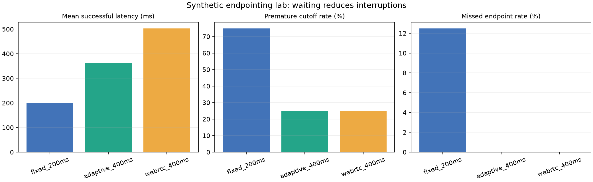

# Endpointing lab

End-of-turn detection is a make-or-break latency problem for speech-to-speech
agents like Phonic's: waiting adds latency, while acting too soon interrupts a
speaker. This small offline Python lab compares fixed energy VAD (200 ms
hangover), calibrated adaptive energy VAD (400 ms), and WebRTC VAD mode 2
(400 ms) on eight deterministic synthetic WAV clips.

## Run

Python 3.10+; from this directory, one command:

```sh
python -m pip install -r requirements.txt && python lab.py
```

After installing dependencies, execution needs no network or API keys.
The script regenerates bundled mono 16 kHz WAVs, prints the per-clip table,
writes results.csv, and renders comparison.png. All clips are synthetic
band-limited noise bursts with pauses, not recorded speech or a speech corpus.



## Measurement

Frames are 20 ms. The first decision after detected activity ends the turn;
decisions before the labeled final burst ends count as premature cutoffs.
Latency is decision time minus that final boundary on successful turns only;
blank CSV latency means cutoff or missed endpoint, distinguished by separate
columns. Each clip is one trial, so per-clip cutoff rates are binary 0/1.
Missing endpoints include never activating and never timing out by clip end.
Adaptive calibration uses the first 300 ms of known silence, then freezes its
threshold at max(0.004, three times the median calibration RMS).

## Discussion

The adaptive threshold handles quiet bursts and background noise better than
the fixed threshold, but its longer hangover still interrupts sufficiently long
internal pauses. WebRTC results on noise bursts illustrate a domain mismatch;
these eight constructed cases cannot establish real speech accuracy or rank
production models, and successful-only latency must be read with failure rates.

This extends the real-time perception focus of my Read The Room video/audio
work into measurable voice-agent turn-taking tradeoffs.
